# Vento hero artwork explorations — 21 October 2026

All original PNGs are preserved unchanged. WebP files are lightweight gallery previews. These are conceptual illustrations, not photographs of delivered products. Generated with built-in imagegen; exact prompts, original filenames, dimensions and SHA-256 hashes are in [manifest.json](manifest.json).

The selected homepage artwork is **engineering-studio-containers**, a targeted revision of **engineering-studio** replacing its two plain blocks with small shipping-container models. Both desktop and mobile use optimized exports of the same scene. CSS fades all four image edges into the page background, and compact screens retain the existing short frame. The original studio scene is preserved in rollback tag `vento-company-v1.14` at `a10d3e8768338e336615ee050ae186f738043a7b`. All earlier images and prompts remain archived below.

## Desktop systems apparatus

[Original PNG](systems-apparatus.png) · [WebP preview](systems-apparatus.webp) · 1374 × 1145

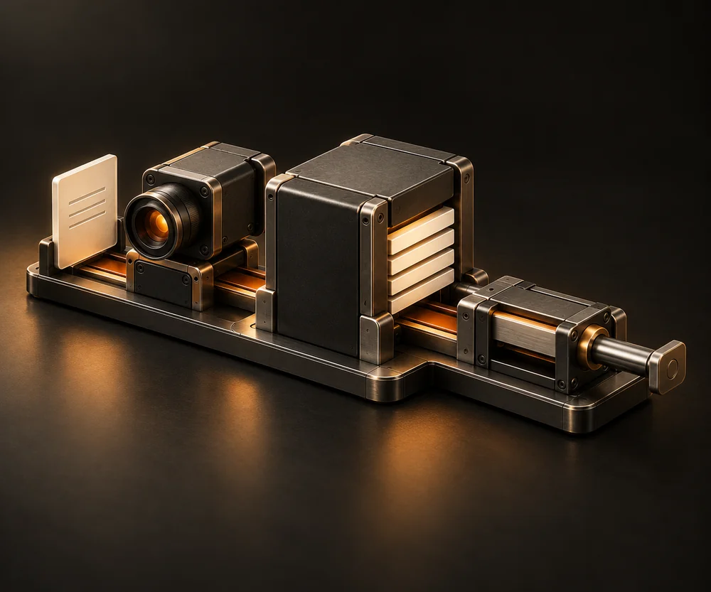

## Engineered weave — desktop

[Original PNG](weave-desktop.png) · [WebP preview](weave-desktop.webp) · 1536 × 1024

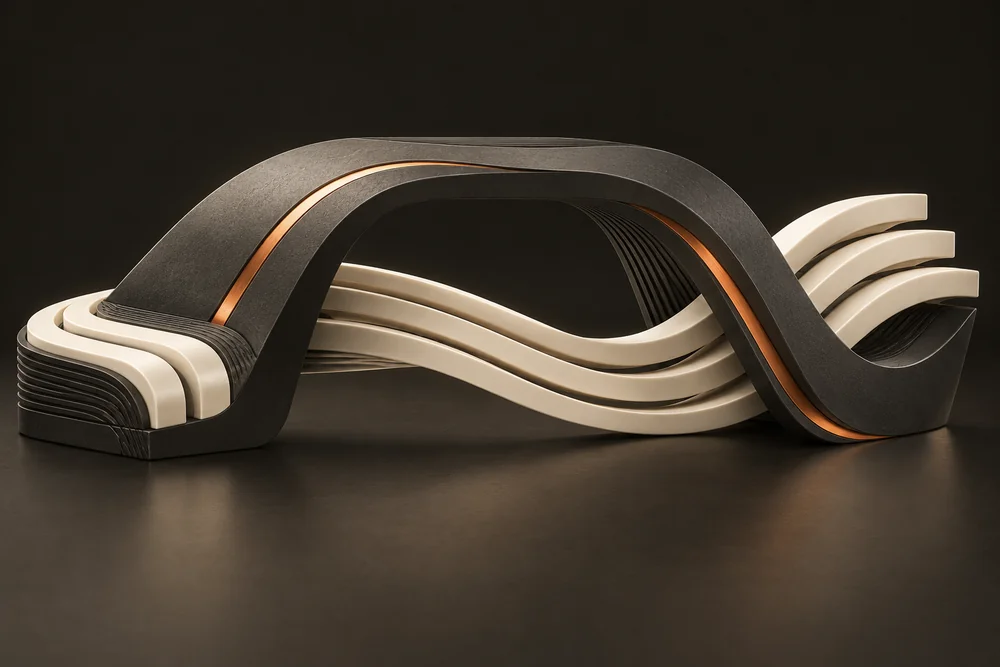

## Engineered weave — compact

[Original PNG](weave-mobile.png) · [WebP preview](weave-mobile.webp) · 1902 × 827

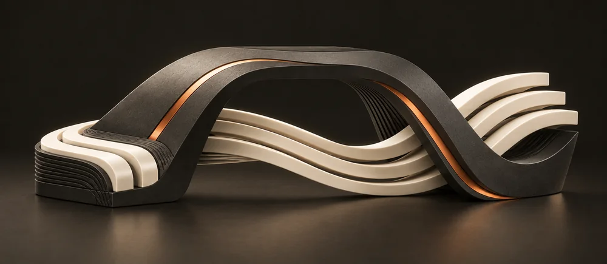

## Plan becoming a working system

[Original PNG](plan-to-system.png) · [WebP preview](plan-to-system.webp) · 1536 × 1024

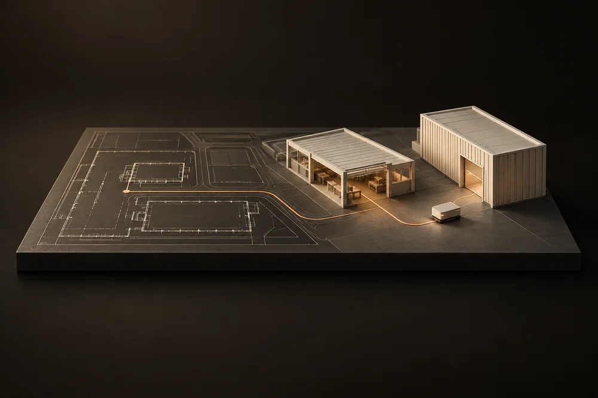

## Human drawing and testing a lidar vehicle

[Original PNG](engineering-studio.png) · [WebP preview](engineering-studio.webp) · 1536 × 1024

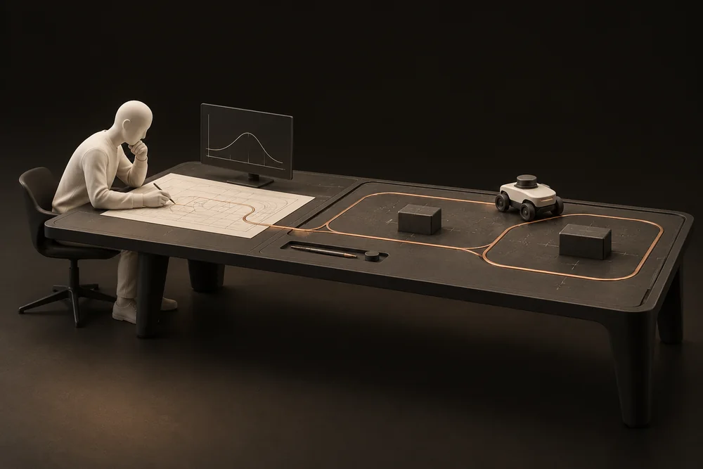

## Plan becoming a working system — compact

[Original PNG](plan-to-system-mobile.png) · [WebP preview](plan-to-system-mobile.webp) · 1902 × 827

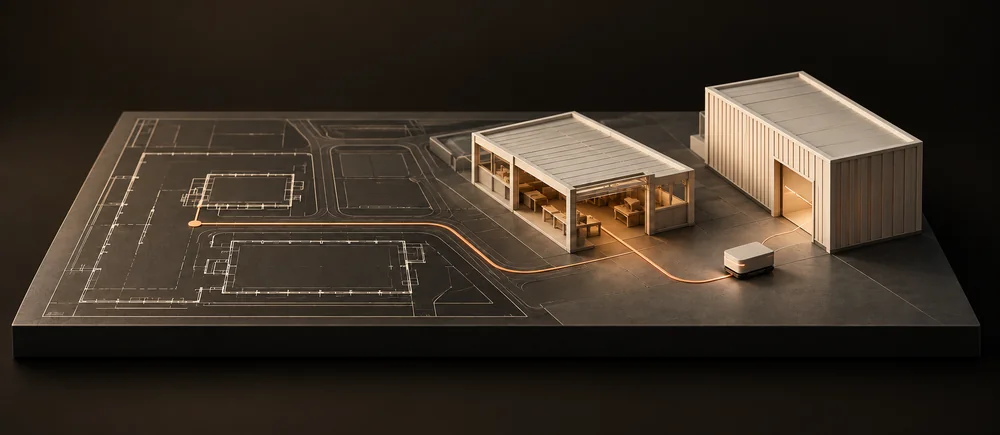

## Human and plan-to-system combined

[Original PNG](combined-human-plan.png) · [WebP preview](combined-human-plan.webp) · 1536 × 1024

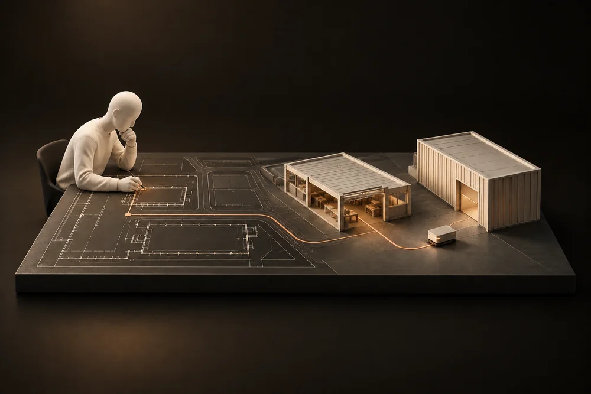

## Combined scene — compact

[Original PNG](combined-human-plan-mobile.png) · [WebP preview](combined-human-plan-mobile.webp) · 1902 × 827

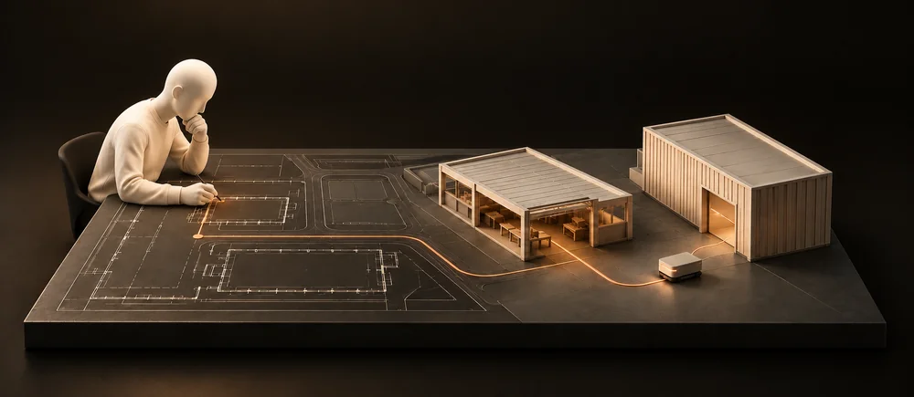

## Drawing paper, smaller warehouses and lidar rover

[Original PNG](paper-and-rover.png) · [WebP preview](paper-and-rover.webp) · 1536 × 1024

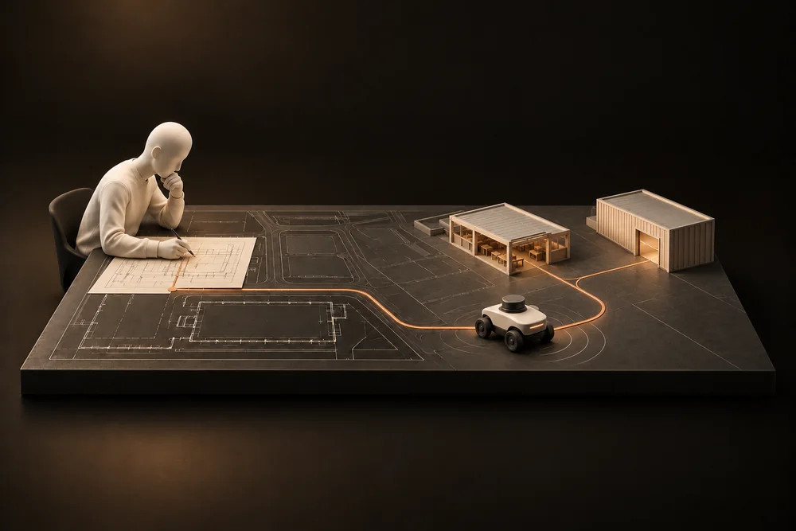

## Larger foreground lidar rover

[Original PNG](large-lidar-rover.png) · [WebP preview](large-lidar-rover.webp) · 1536 × 1024

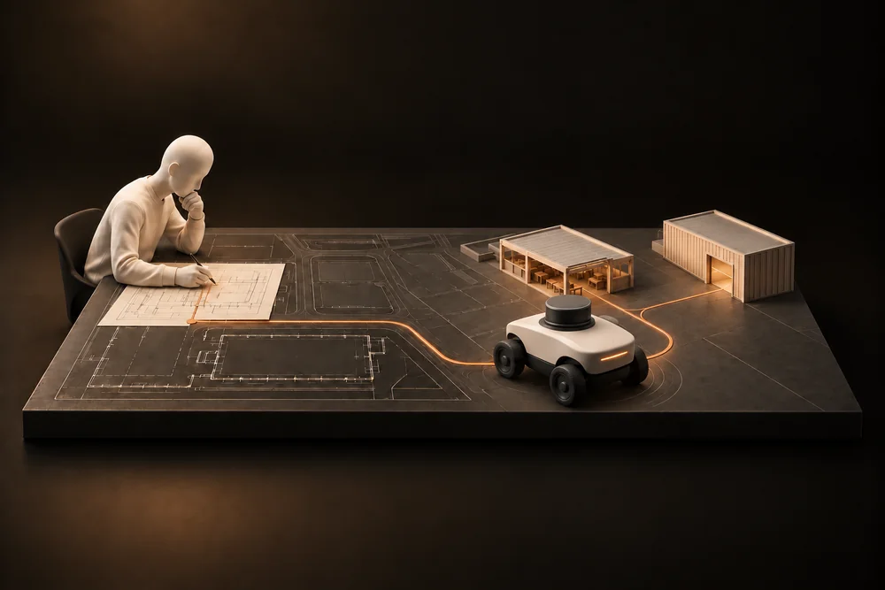

## Larger lidar rover — compact

[Original PNG](large-lidar-rover-mobile.png) · [WebP preview](large-lidar-rover-mobile.webp) · 1902 × 827

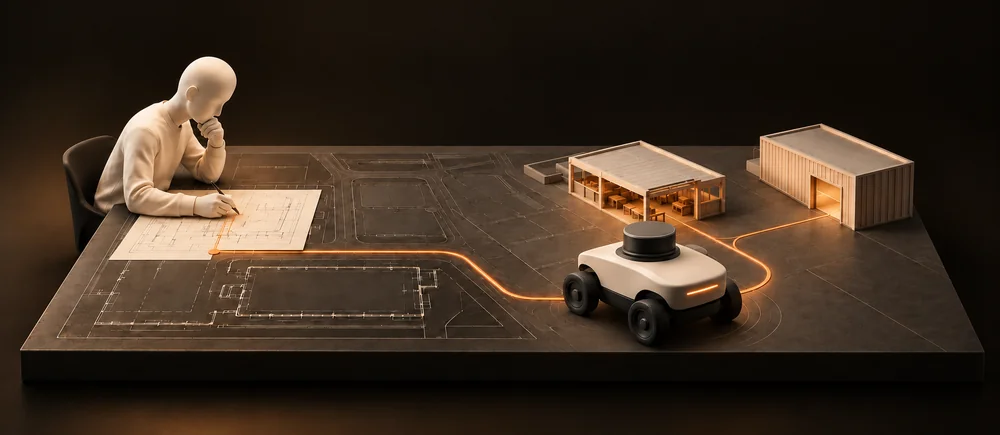

## Final: paper, graphs, large lidar rover and smaller warehouses

[Original PNG](graphs-lidar-final.png) · [WebP preview](graphs-lidar-final.webp) · 1536 × 1024

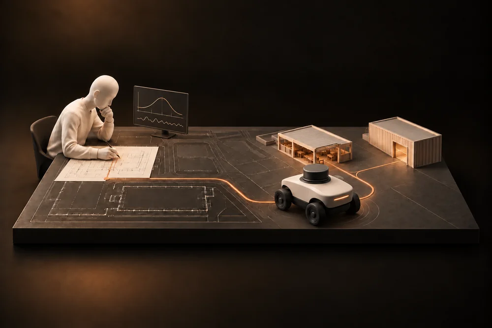

## Final scene — compact

[Original PNG](graphs-lidar-final-mobile.png) · [WebP preview](graphs-lidar-final-mobile.webp) · 1902 × 827

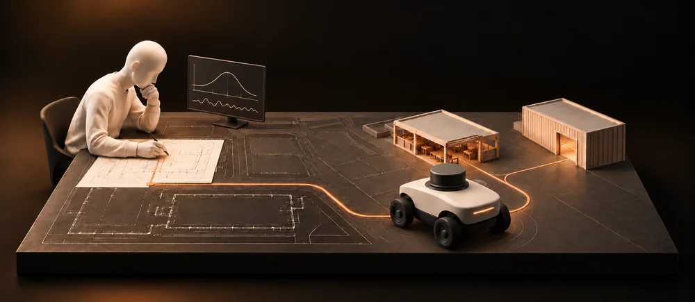

## Engineering studio with small shipping containers

[Original PNG](engineering-studio-containers.png) · [WebP preview](engineering-studio-containers.webp) · 1536 × 1024

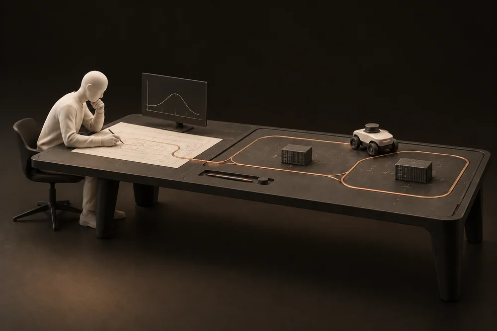
